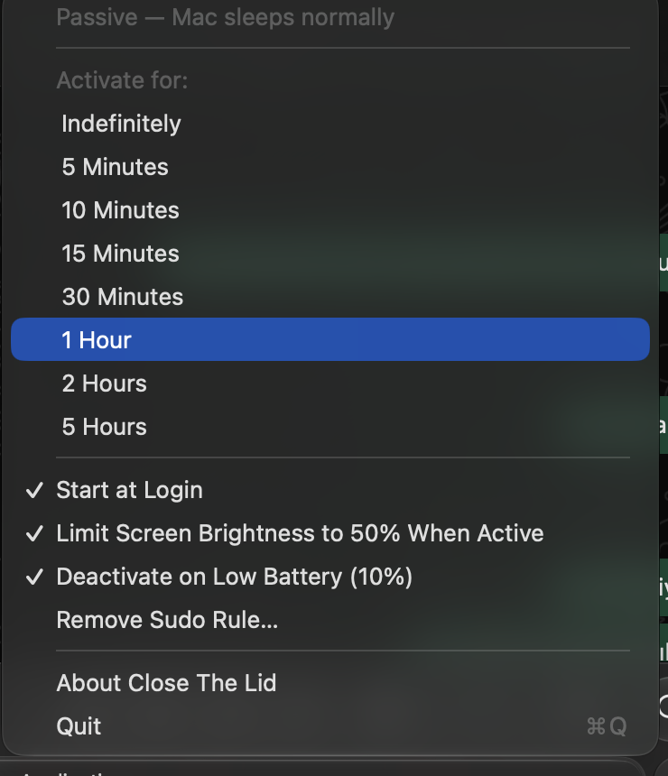

<p align="center"></p>

<h1 align="center">Close The Lid</h1>

<p align="center">A tiny macOS menu bar app (Apple Silicon, macOS 13+) that lets your MacBook keep running with the lid closed.</p>

<p align="center"></p>

- **Active:** runs `sudo pmset -a disablesleep 1` → close the lid, the Mac keeps working.
- **Passive:** runs `sudo pmset -a disablesleep 0` → normal sleep behaviour.

## Features
- Menu bar icon: laptop outline (passive) / laptop with bolt (active), adapts to light & dark menu bars.
- Activate indefinitely, or for 5 / 10 / 15 / 30 minutes, 1 / 2 / 5 hours; countdown shown next to the icon and in the menu.
- Starts at login, always in passive mode.
- Asks for your admin password **once** (see below).
- Optional: caps the built-in screen at 50% brightness while active (left as is if already lower; restored on deactivate/quit).
- Safety: re-enables sleep on quit, at launch if it was left disabled, on shutdown, and when on battery ≤ 10%.

## Install
1. Download `CloseTheLid.dmg` from the [latest release](../../releases/latest), open it and drag **Close The Lid** to **Applications**.
2. Launch it. The app is ad-hoc signed (not notarized). If macOS blocks it on another Mac, open
   **System Settings → Privacy & Security** and click **Open Anyway**.
3. The first time you activate it, you'll see a one-time setup dialog followed by the macOS admin password prompt.

## How "sudo once" works
On first activation the app installs `/etc/sudoers.d/close-the-lid`, validated with `visudo`:

```
"<you>" ALL=(root) NOPASSWD: /usr/bin/pmset -a disablesleep 0, /usr/bin/pmset -a disablesleep 1
```

This allows your account to run only those two exact commands without a password. Use **Remove Sudo Rule…** in the menu to delete it.

## Settings
- Battery threshold: `defaults write com.bugrasitemkar.closethelid batteryThreshold 15`
- Logs: `log show --last 1h --info --predicate 'subsystem == "com.bugrasitemkar.closethelid"'`

## Build
```
./scripts/build-app.sh   # → dist/Close The Lid.app
./scripts/make-dmg.sh    # → dist/CloseTheLid.dmg
```
Requires Xcode command-line tools. No third-party dependencies.

## Uninstall
Choose **Remove Sudo Rule…**, quit the app, then delete it from Applications. If sleep ever seems stuck,
run `sudo pmset -a disablesleep 0`.

> ⚠️ With the lid closed and sleep disabled, the Mac can get warm in a bag. Use timed activation when you can.
